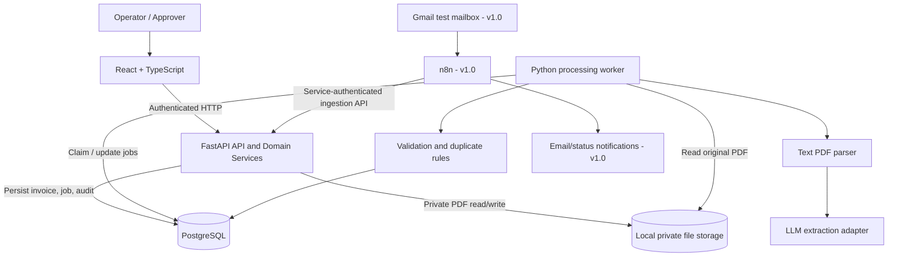

# InvoiceFlow AI — System Architecture

**Document ID:** IF-ARCH-001  
**Version:** 0.1.0-draft  
**Status:** Proposed for review — Task 1.2  
**Related specification:** `PROJECT_REQUIREMENTS.md` v0.1.0  
**Implementation status:** Not implemented; no Codex prompts issued

## 1. Architecture decision

**Style:** modular monolith implemented as a FastAPI application and a separate Python processing worker sharing a Python codebase, backed by PostgreSQL and private file storage. A React/TypeScript client is the operator/approver interface. n8n is an integration/orchestration layer added in v1.0 for Gmail ingestion and notifications.

This is a deliberately constrained design for a reproducible portfolio MVP; it is **not** a production readiness or scaling guarantee.

### Primary principles

1. **Single source of truth:** PostgreSQL owns invoice records, processing-job state, and audit events.
2. **Domain authority:** Python domain services own validation, duplicate handling, authorization decisions, and lifecycle transitions. Neither React nor n8n may change lifecycle state arbitrarily.
3. **Separation of execution:** HTTP submission is fast; an independently run Python worker performs potentially slow/unreliable document and LLM processing.
4. **Explicit failures:** Job failures are recorded; retry attempts are controlled and cannot silently create additional payable invoices.
5. **Least privilege:** Documents and API endpoints are authenticated and role protected; provider keys and service credentials stay server-side.
6. **Incremental delivery:** Core manual-upload MVP v0.1 first, external automation/OCR v1.0 later.

## 2. Logical component diagram

The worker calls reusable domain services from the **same Python codebase** used by the API; the diagram shows responsibilities, not a mandate for microservices.

## 3. Component responsibilities and prohibited ownership

| Component | Owns | Does NOT own |
| --- | --- | --- |
| React/TypeScript | User interaction, upload form, invoice list/details, corrections, approval UI, polling status | Business rules, credential secrets, authoritative status transitions |
| FastAPI (API + shared domain package) | Authentication/session checks, authorization, upload limits, lifecycle commands, storage metadata, duplicate policy, persistence and audit APIs | Long-running processing inside a user HTTP request |
| PostgreSQL | Invoice records, job records/attempts, users/sessions, audit history, uniqueness constraints | Original binary PDF files |
| Python worker | Durable job claiming, text parsing, model extraction, validation orchestration, state updates/retries | Approving/rejecting invoices on behalf of human users |
| Private PDF storage | Original file bytes at generated names, accessible only to backend/worker | Public static document URLs |
| n8n (v1.0) | Gmail trigger, attachment forwarding, notification workflows, integration execution traces | Invoice validation algorithms, direct database writes, financial approval |
| External LLM | Candidate structured field extraction | Truth, final validation, lifecycle authority |

## 4. Primary sequence — manual upload MVP v0.1

1. Authenticated operator submits one <=10 MB English text-based PDF through React.
2. FastAPI validates user role, uploaded content/signature, size, and document constraints. Fail closed on invalid/corrupt uploads; do not accept based only on filename or HTTP Content-Type.
3. FastAPI computes a content digest. An exact existing PDF returns an explicit duplicate outcome/reference without another active payable record.
4. If new, FastAPI writes the file under a generated identifier in private storage and persists an `invoice_document`, an initial `RECEIVED` status, a processing job, and an audit event. Use temp-file/atomic rename and compensate/clean up on persistence failure, since filesystem + DB are not one atomic transaction.
5. API returns promptly with **202 Accepted** and a persisted document identifier. React queries the document status; it does not wait for LLM extraction in the upload HTTP request.
6. The separate worker claims pending jobs using a transaction-safe leasing mechanism, marks invoice `PROCESSING`, and reads the stored PDF. Only one worker may claim a job at a time.
7. The text parser extracts candidate source text. The LLM adapter produces a typed candidate field set; unknowns remain null/flagged, not fabricated.
8. Shared domain services normalize/check fields, arithmetic, and likely duplicate invoice identities (normalized vendor + invoice number). The result is atomically saved with validation issues and audit events.
9. Eligible documents move to `PENDING_APPROVAL`; ambiguous/inconsistent/likely duplicate documents move to `NEEDS_REVIEW` or the explicitly defined duplicate outcome; processing failures move to `FAILED`.
10. Operator reviews and corrects when needed. Backend reruns validation; an authorized Approver can explicitly `APPROVE` or `REJECT` only invoices in `PENDING_APPROVAL`. Audit events record actor, time, and reason/details.

### Example request/response (illustrative; final contracts are Task 1.3)

- `POST /api/v1/invoices` -> HTTP 202 + `document_id`, status `RECEIVED`.
- `GET /api/v1/invoices/{document_id}` -> status, extracted fields, validation issues, permitted actions.
- Authentication, corrections, decisions, duplicate response shape, and retry endpoints will be specified in Task 1.3.

## 5. Processing-job design

**Decision:** PostgreSQL-backed durable job table + simple standalone Python worker, not Celery/Redis for v0.1. The job table contains at minimum a unique job ID, linked document ID, status, attempt count, claimed/lease timestamps, next retry time, last error category, and correlation ID. Exact schema deferred to Task 1.3.

**Important reliability invariants:**

- Job acquisition must be transactional/concurrency-safe (e.g., row locks with `FOR UPDATE SKIP LOCKED`) so two workers cannot process the same claim concurrently in normal operation.
- Worker crashes leave a job recoverable after its lease expires; a watchdog or worker startup check returns safely recoverable jobs to pending state.
- Retrying the same job does not create a second invoice/payable record. Domain writes must be idempotent even if the external LLM call repeats.
- Failed provider calls have bounded retries/backoff for transient issues; permanent validation errors are recorded and not retried endlessly.
- Record job attempts separately from invoice lifecycle, so `FAILED` vs `NEEDS_REVIEW` remains meaningful.
- A transactional uniqueness rule protects normalized vendor + invoice-number business identity where applicable; potentially ambiguous matches require review instead of blind deletion.
- A single-worker MVP is sufficient; design for safe multiple-worker claims without promising horizontal scale.

## 6. File storage

**MVP:** Docker named volume or host-mounted directory outside the frontend's/public webroot, readable by API/worker only. PostgreSQL stores document metadata, generated relative storage key, hash, size, uploader and timestamps; binary PDFs are not stored as DB blobs.

- Keep original client filename as sanitized display metadata only.
- Generate collision-resistant storage names/IDs.
- Inspect actual PDF signature/content, reject malformed/inaccessible inputs, enforce 10 MB and resource/page-count limits.
- Serve documents only through authorized backend streaming/download routes, never direct public paths.
- Consider PDF parser isolation and document scanning for any real-world/production deployment; synthetic fixtures only in the project.
- For later cloud hosting, replace local volume with private object storage via a storage abstraction; avoid building that now.

## 7. Authentication and authorization

**Proposed for v0.1:** two seeded demo user accounts (Operator and Approver) with securely hashed passwords, a backend-managed opaque server-side session, and an HttpOnly cookie. Cookie settings must be appropriate for local HTTP dev vs HTTPS deployment; mutating actions need CSRF/Origin protection. React only changes UI affordances; FastAPI enforces permission checks.

**n8n v1.0:** separate service credential/limited service identity for the ingestion API, carried over private local Docker networking or secure HTTPS if remote. Never reuse an interactive user password, call database tables directly from n8n, or put provider secrets in React.

Detailed token/cookie/session endpoints, expiration, role matrix and CSRF strategy are Task 1.3.

## 8. State model and review flow

- `RECEIVED -> PROCESSING`
- `PROCESSING -> PENDING_APPROVAL | NEEDS_REVIEW | FAILED | DUPLICATE`
- `NEEDS_REVIEW -> PENDING_APPROVAL` only after operator correction and successful revalidation
- `FAILED -> PROCESSING` only via authorized controlled retry
- `PENDING_APPROVAL -> APPROVED | REJECTED` only via explicit human decision
- No direct approval from `RECEIVED`, `PROCESSING`, `NEEDS_REVIEW`, `FAILED`, or `DUPLICATE`.

Validation issues (for example missing tax context or arithmetic mismatch) are **data**, not server exceptions. Actual parser/provider/timeouts are **processing failures**. This distinction governs `NEEDS_REVIEW` vs `FAILED`.

## 9. External automation path — v1.0

1. n8n watches a dedicated test Gmail mailbox for eligible messages with PDF attachments.
2. n8n forwards attachment(s) to FastAPI through a service-authenticated ingest endpoint, with stable upstream message/attachment IDs or idempotency keys.
3. FastAPI performs the **same** intake checks and creates the **same** durable jobs used for React uploads; no parallel ingestion logic.
4. n8n records the API acceptance ID. A later notification workflow can be driven by an authenticated backend status event or bounded status polling. A robust event outbox is a possible v1.0 enhancement if reliable notification delivery becomes necessary.
5. n8n is never allowed to directly `APPROVE`, overwrite validation flags, or manipulate PostgreSQL records.

No n8n instance, Gmail credentials, public webhook, or email provider is required for the v0.1 MVP.

## 10. Development deployment topology

**Docker Compose (proposed):**

- `frontend`: React dev server/build served locally.
- `api`: FastAPI app, shared project code.
- `worker`: Python process using same domain package, polling/leasing jobs.
- `db`: PostgreSQL with persistent volume.
- `n8n`: optional Compose profile added during v1.0 (with its own persistence/configuration), using the API rather than writing into application tables.
- `pdf_store`: private persistent volume shared by API and worker, not mounted by frontend or n8n.

The precise frontend serving choice, image build and database migrations are implementation details. Do not add Redis, Celery, Kubernetes, object storage, or a second domain database unless measured needs demand it.

## 11. Error scenarios and expected behavior

| Scenario | Expected system behavior |
| --- | --- |
| Invalid, oversized or unsupported PDF | Reject with understandable API error; no processable payable record |
| Same exact PDF submitted twice | Return duplicate reference/status; do not create second active record |
| Same normalized vendor + invoice number across different PDFs | Flag a likely business duplicate and block approval until resolved under an explicit policy |
| Missing or inconsistent extracted values | Record validation issues, set `NEEDS_REVIEW`; never silently fabricate fields |
| LLM timeout or rate limit | Record attempt, bounded retry/backoff; eventually `FAILED` if unresolved |
| Worker process crashes mid-job | Lease recovery and idempotent reprocessing; no lost job or second record |
| Unauthorized approval API request | Deny server-side, keep state unchanged, audit security-relevant actions |
| Database unavailable during upload | Return failure; do not claim successful persisted acceptance; clean up orphan file where possible |
| n8n Gmail event delivered twice (v1.0) | Upstream event idempotency + file/business duplicate checks prevent double payable creation |

## 12. Monitoring and evaluation hooks

Correlate `document_id`, `processing_job_id`, and `correlation_id` across status transitions, processing attempts and logs. Instrument extraction stage latency, provider token usage/cost (if available), parsing failures, duplicate outcomes, manual corrections, approval waiting time, and final acceptance metrics. Do not treat pending human approval time as automatic system-processing latency.

## 13. Decisions deferred to Task 1.3

- Tables, indexes, unique constraints, model relationships, migration strategy.
- Stable Pydantic request/response schemas and route catalog.
- Explicit job lease/retry parameters and transaction boundaries.
- Exact duplicate policy on conflict/corrections and re-submissions.
- Login/session API and exact role permissions.
- Storage route access rules and upload error code taxonomy.
- Detailed state transition guards and audit event payloads.

## 14. Task 1.2 acceptance / Definition of Done

- [x] Each logical component has one clear primary responsibility.
- [x] Main upload, processing, review and approval sequence is specified.
- [x] Async execution, persistence, file storage, and trust boundaries are proposed.
- [x] Failures, duplicate submissions, retries, and worker crashes have an intended handling path.
- [x] v0.1 core is separated from v1.0 n8n + Gmail integration.
- [x] Diagram and document drafted.
- [ ] User reviews/accepts this proposed design.

**Next after approval:** Task 1.3 — Database Schema, State Transition Rules and API Contracts. **No Codex implementation prompt before that task is reviewed.**
