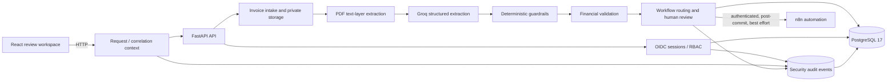

# InvoiceFlow AI

[](https://github.com/Mostafa-khaled11/invoiceflow-ai/actions/workflows/ci.yml) [](LICENSE)

InvoiceFlow AI is an engineering portfolio project for AI-assisted invoice
processing. It combines structured document extraction with deterministic
financial validation, PostgreSQL-backed workflow state, authenticated human
review, and optional n8n automation.

This is a portfolio and development system, not a commercially production-
certified SaaS product. The repository emphasizes inspectable engineering
boundaries, reproducibility, security controls, and honest failure handling.

## What the system does

Invoice processing needs more than field extraction. The system preserves the
source PDF, extracts structured invoice data, validates financial relationships,
routes exceptions to human review, and records the resulting workflow history.

Implemented capabilities include:

- PDF upload validation, private named-volume storage, and SHA-256 duplicate
  detection.
- Digital PDF text-layer extraction with `pypdf`; OCR is intentionally out of
  scope.
- Versioned Groq structured extraction behind a provider boundary, with shared
  deterministic guardrails and schema validation.
- Deterministic financial/business validation with persisted findings and
  `PASS`, `WARNING`, `REVIEW_REQUIRED`, and `BLOCKED` decisions.
- Workflow routing, review queues, review detail, and human resolution through
  `ACCEPT_EXCEPTION` or `REJECT`.
- Backend OIDC authentication, server-side sessions, CSRF protection, and
  centralized role-based authorization.
- Actor-scoped review-command idempotency and authenticated post-commit n8n
  notifications.

The React application is currently an authenticated-backend review workspace;
frontend OIDC/login integration is deferred.

## Engineering highlights

1. **Modular FastAPI monolith** — HTTP endpoints, domain services, persistence,
   provider boundaries, and integrations are separated without introducing a
   worker platform that the current workload does not require.
2. **Safe AI boundary** — prompt and schema versions are selected through
   registries; provider output passes through deterministic monetary/date
   guardrails before `StructuredInvoiceData` validation.
3. **Financial correctness** — business validation is deterministic and
   versioned, so model extraction does not silently become a business decision.
4. **PostgreSQL as source of truth** — SQLAlchemy models, Alembic migrations,
   foreign keys, uniqueness constraints, and transaction boundaries protect
   durable workflow state.
5. **Backend security boundary** — provider-neutral OIDC Authorization Code +
   PKCE, opaque server-side sessions, CSRF/origin checks, and centralized RBAC
   are enforced before protected operations.
6. **Replay-safe review commands** — canonical `review-resolution-v1` SHA-256
   fingerprints, actor-scoped uniqueness, row locks, and savepoint recovery
   protect concurrent review resolution.
7. **Traceable operations** — backend-generated request IDs, validated
   correlation IDs, sanitized security-audit events, and trusted actor
   attribution make important security operations inspectable.
8. **Reproducible verification** — unit tests, isolated PostgreSQL tests,
   migration smoke tests, frontend tests, Playwright, static analysis,
   dependency audits, and Compose validation run as explicit quality gates.

## System architecture



FastAPI owns application decisions and PostgreSQL is the durable source of
truth. Groq is called only from the server-side provider boundary. n8n is an
optional downstream automation boundary and does not own invoice or workflow
state. The detailed implementation map is in
[docs/architecture.md](docs/architecture.md).

## Data integrity and security

Review resolution persists the state transition, workflow event, and command
record in one caller-owned transaction. The command record uses:

- actor scope plus the existing resolution request key as its uniqueness scope;
- a versioned canonical payload containing operation, invoice, workflow,
  review-case, decision, and nullable note;
- compact sorted JSON serialized as UTF-8 and hashed with SHA-256;
- PostgreSQL row locks and savepoint recovery for insert races.

An identical same-actor replay returns the recorded result without a duplicate
workflow event or n8n notification. A conflicting reuse of the same key is
rejected, while a different actor has a separate scope. These controls do not
claim exactly-once delivery to external webhooks: n8n delivery remains
authenticated, post-commit, and best effort because no transactional outbox is
implemented.

Security events use trusted server-side actor identities and explicit metadata
allowlists. Request IDs are generated by the backend; correlation IDs are
bounded and validated, never used as authentication. Raw OIDC tokens,
authorization codes, cookies, session secrets, provider credentials, and free-
form audit reasons are not persisted. Application behavior is append-only for
audit records, while database-level privilege hardening and retention policy
remain deferred. See the [PR-01 security closure](docs/security/pr01-security-closure.md).

## Software engineering practices

- **Separation of concerns:** routes adapt HTTP, services own domain behavior,
  models define persistence, and providers/integrations are explicit seams.
- **Type safety:** Python is checked with Pyright and Ruff; TypeScript is
  compiled and linted in the frontend pipeline.
- **Explicit state:** workflow states, review status, validation decisions,
  actor types, and audit event types are constrained rather than inferred from
  free-form strings.
- **Dependency injection and test seams:** FastAPI dependencies, SQLAlchemy
  sessions, fake OIDC/provider boundaries, and intercepted browser APIs keep
  tests deterministic.
- **Transactional persistence:** migrations, foreign keys, unique constraints,
  row locking, rollback behavior, and isolated disposable databases are tested
  separately from SQLite-only unit coverage.
- **Reproducibility:** synthetic evaluation data uses deterministic generation;
  dependency lockfiles and CI checks make environment drift visible.
- **Secure configuration:** `.env` is ignored, `.env.example` contains
  placeholders, and secrets are kept server-side rather than in React bundles,
  workflow exports, or source control.

## Authentication and authorization

The backend implements a provider-neutral OIDC relying-party boundary using
Authorization Code Flow with PKCE. Successful authentication creates an opaque
server-side session; only a SHA-256 verifier and session metadata are stored.
Sessions have idle/absolute expiry, revocation, and logout handling. Logout is
protected by CSRF and trusted-origin checks.

Authorization is centralized in `AuthorizationContext` and the permission
matrix. Human actors come from the authenticated local account, while the n8n
API monitor uses a separately scoped service principal. Request headers, body
fields, query parameters, and correlation IDs cannot establish actor identity.

The frontend does not yet implement the browser OIDC login flow. Local and CI
tests use a fake or mocked OIDC boundary; that is test infrastructure, not a
second application authentication system.

## Testing and CI/CD

The repository separates fast local checks, disposable PostgreSQL verification,
and browser/frontend checks:

| GitHub Actions job | Main coverage |
| --- | --- |
| **Backend quality** | Deterministic dataset generation/validation, Pytest, Ruff, and Pyright |
| **Frontend quality** | `npm ci`, ESLint, Vitest, coverage, and Vite build |
| **Browser E2E** | Chromium Playwright review-workspace flows with intercepted APIs |
| **Dependency security audit** | Python environment/runtime-image and full/production npm audits |
| **Infrastructure validation** | Docker Compose configuration validation |
| **PostgreSQL integration** | PostgreSQL 17 service, Alembic migration smoke test, and full suite |

Latest approved local security-closure evidence:

- Full local backend/evaluation suite: **330 passed, 28 skipped, 2 warnings**.
  Local skips include PostgreSQL-gated tests without `TEST_DATABASE_URL`,
  optional capability skips, and the intentionally disabled live Groq smoke
  test.
- Isolated PostgreSQL integration run: **25 passed, 1 skipped, 331
  deselected**; the remaining skip was the intentional live Groq smoke test.
- Fresh isolated Alembic migration smoke: **1 passed, 1 warning**, ending at
  revision `a7b8c9d0e1f2`.
- Ruff, Ruff format, Pyright, frontend checks, dependency audits, and Compose
  validation passed in the recorded quality-gate evidence.

The PostgreSQL run and migration smoke use separate disposable databases. This
is deliberate: the general test fixture uses `Base.metadata.create_all()` and
can remove migration-managed tables before an independent migration smoke test.
The counts above are separate evidence sets and must not be combined. The
approved [security closure](docs/security/pr01-security-closure.md) records
the exact procedure and limitations. The merged PR #7 CI checks also passed;
run CI again for any new change rather than treating historical evidence as a
current execution.

## Technology stack

| Area | Technologies |
| --- | --- |
| API | Python 3.12+, FastAPI, Pydantic, SQLAlchemy 2, Alembic |
| Frontend | React 19, TypeScript, Vite |
| AI boundary | Groq structured extraction, versioned prompts and schema |
| Database | PostgreSQL 17, psycopg |
| Automation | n8n webhooks and scheduled workflow |
| Testing | Pytest, Vitest, React Testing Library, MSW, Playwright |
| Quality/security | Ruff, Pyright, ESLint, TypeScript, pip-audit, npm audit |
| Local runtime | Docker Compose, named volumes |

## Quick start

### Prerequisites

- Docker Desktop with Compose v2
- Python 3.12+ for host-side backend checks
- Node.js 20.19+ or 22.12+ for host-side frontend checks

### Start the local stack

From the repository root in Windows PowerShell:

```powershell
Copy-Item .env.example .env
# Set a local POSTGRES_PASSWORD and matching DATABASE_URL password in .env.

docker compose build api frontend
docker compose up -d db
docker compose run --rm api alembic upgrade head
docker compose up -d api frontend
docker compose ps

Invoke-WebRequest http://localhost:18000/api/v1/health
Invoke-WebRequest http://localhost:18000/api/v1/ready
```

Open the review workspace at <http://localhost:5173> and API documentation at
<http://localhost:18000/docs>. n8n is available at
<http://localhost:5678> when explicitly enabled and configured. Compose binds
these host services to loopback; this is local-development hardening, not
production HTTPS or deployment security.

The browser-visible API base URL is `http://localhost:18000`. The internal API
hostname is `http://api:8000` and is used only inside the Compose network.

Stop the stack without deleting local data:

```powershell
docker compose down
```

Do not use `docker compose down -v` as routine cleanup: it intentionally deletes
local PostgreSQL, invoice-storage, and n8n volumes.

### Backend checks

```powershell
python -m venv .venv
.\.venv\Scripts\Activate.ps1
python -m pip install --upgrade pip
python -m pip install -e ".\backend[dev,evaluation]"
python -m pytest -q
python -m ruff check backend
python -m ruff format --check backend
python -m pyright backend
python -m pyright
```

By default these tests use fake providers and isolated SQLite fixtures. They do
not call Groq, n8n, or customer services. PostgreSQL-gated tests require an
explicit `TEST_DATABASE_URL`; use a disposable database and follow the
separate migration-smoke procedure in the security closure.

### Frontend and security checks

```powershell
Set-Location frontend
npm ci
npm run lint
npm test
npm run test:coverage
npm run build
npm audit --audit-level=high
npm audit --omit=dev --audit-level=high

Set-Location ..
python -m pip install pip-audit==2.10.1
python -m pip_audit --local --format=columns
docker compose config --quiet
```

For browser verification, install Chromium with
`npx playwright install chromium`, then run `npm run test:e2e` from
`frontend/`. The browser suite uses synthetic fixtures and intercepted API
routes; it does not require the Docker stack.

## API surface

All application endpoints are under `/api/v1`.

| Method | Path | Responsibility |
| --- | --- | --- |
| GET | `/api/v1/health` | Liveness without a database query |
| GET | `/api/v1/ready` | PostgreSQL readiness; returns 503 when unavailable |
| POST | `/api/v1/invoices/upload` | Validate and persist one PDF |
| GET | `/api/v1/invoices/{id}` | Read invoice metadata |
| POST | `/api/v1/invoices/{id}/extract-text` | Persist digital text extraction metadata |
| POST | `/api/v1/invoices/{id}/extract-structured` | Run configured structured extraction |
| POST | `/api/v1/invoices/{id}/validate` | Persist deterministic validation |
| GET | `/api/v1/invoices/{id}/validation` | Read current validation findings |
| POST | `/api/v1/invoices/{id}/workflow/route` | Create/read current workflow route |
| GET | `/api/v1/invoices/{id}/workflow` | Read current workflow state |
| POST | `/api/v1/invoices/{id}/workflow/review` | Resolve an open review case |
| GET | `/api/v1/review-cases` | List current or historical review cases |
| GET | `/api/v1/review-cases/{id}` | Read review and validation context |

## Project structure

```text
backend/app/                 FastAPI routes, services, models, schemas, prompts
backend/tests/               Backend, evaluation, integration, and security tests
backend/alembic/             PostgreSQL migration history
frontend/src/                React UI, API client, unit/component tests
frontend/e2e/                Mocked Chromium workflows
evaluation/                  Synthetic benchmark tooling and diagnostics
n8n/workflows/               Exported local automation workflows
docs/                        Architecture, security, demo, roadmap, milestones
.github/workflows/ci.yml     Six-job quality and security pipeline
compose.yaml                 Local API, frontend, PostgreSQL, and n8n topology
```

## Known limitations and deferred work

- This is a portfolio/development project, not production-certified software.
- Frontend OIDC/login integration is deferred; backend authentication and RBAC
  are implemented separately.
- n8n delivery is authenticated post-commit best effort; there is no durable
  transactional outbox or persistent retry queue.
- OCR for image-only PDFs is not implemented.
- There is no cloud deployment, full production observability, audit read/
  retention infrastructure, or database-level audit privilege hardening.
- No administrative role-management HTTP API exists yet.
- The frontend is a review workspace rather than a complete invoice-upload
  product.
- Synthetic AI evaluation is an engineering and reproducibility tool, not a
  claim of production model accuracy.

## Documentation and demonstration

- [Implementation architecture](docs/architecture.md)
- [PR-01 security architecture](docs/security/pr01-security-architecture.md)
- [PR-01 API access matrix](docs/security/pr01-api-access-matrix.md)
- [PR-01 security closure](docs/security/pr01-security-closure.md)
- [PR-01D audit architecture](docs/security/pr01d-audit-architecture.md)
- [Portfolio demo walkthrough](docs/demo.md)
- [Roadmap](docs/roadmap.md)
- [Synthetic evaluation tooling](evaluation/README.md)

The [demo walkthrough](docs/demo.md) uses synthetic and mocked evidence. It
does not require live provider calls or mutate customer data. Product preview
captures are available in [docs/assets](docs/assets):
[review queue](docs/assets/review-queue.png) and
[review detail](docs/assets/review-detail.png).

## License

This project is released under the MIT License. See [LICENSE](LICENSE).
